<div align="center">

# Dron Submarino

**Controlador de un dron submarino ideal con el microcontrolador 80C552**


Práctica final · Arquitectura de Computadores · curso 2026-2027
Grado en Ingeniería Informática de Gestión y Sistemas de Información · UPV/EHU


</div>

---

## Descripción

Software de control para un pequeño dron submarino. El dron sigue un recorrido
automático a partir de un programa guardado en la memoria de datos (de `0x50` a `0x7F`),
midiendo profundidad y distancia con sensores analógicos y moviendo sus hélices mediante PWM.

El programa está organizado como una **máquina de estados** (estados – eventos – acciones).

## Simulación

Animación del funcionamiento con un programa de ejemplo (`C2 A5 D3 A4 F`): el dron baja a 5 m, avanza 5 s,
gira a la derecha 3 s y avanza hasta que el sónar detecta un obstáculo a menos de 0,2 m, momento en que aborta
el rastreo y sube. Se muestran la vista lateral, la vista cenital, la máquina de estados, los displays de
siete segmentos y las salidas (PWM0, PWM1, Giro_Avance y Subir_Bajar).

<div align="center">

</div>

> Ilustración del comportamiento esperado, no la ejecución del código.

## Hardware

| Elemento | Detalle |
|---|---|
| Microcontrolador | Philips 80C552 |
| Reloj | Cristal de 24 MHz |
| Botón Marcha/Paro | P3.2 (interrupción externa) |
| Sensor de presión (profundidad) | ADC, P5.0 |
| Sensor de distancia (sónar frontal) | ADC, P5.1 |
| Hélices de profundidad | PWM0 + P1.5 (subir/bajar) |
| Hélices de giro/avance | PWM1 + P1.7, P1.6 |
| Visualización | Dos displays de 7 segmentos (P2 y P0) |

## Instrucciones del recorrido

Cada instrucción ocupa un byte: 4 bits altos = acción, 4 bits bajos = parámetro.

| Código | Acción | Parámetro |
|:---:|---|---|
| `C` | Subir / bajar | Profundidad (0 a 4) |
| `A` | Avanzar | 1–F segundos |
| `D` | Girar a la derecha | 1–F segundos |
| `E` | Girar a la izquierda | 1–F segundos |
| `F` | Fin (el dron sube) | – |

## Estructura del repositorio

```
.
├── README.md
├── img/
│   ├── dron_submarino.jpg       # imagen del enunciado de la práctica
│   └── simulacion_dron.svg      # simulación animada del funcionamiento
└── src/
    ├── src-dron_submarino.a     # código fuente en ensamblador
    └── *.Uv2 / *.Opt            # archivos de proyecto de Keil uVision2
```

## Cómo trabajar con el proyecto

1. Abre `src/src-dron_submarino.Uv2` con Keil uVision2.
2. Compila y simula desde el propio entorno.

### Normas del equipo

- Todo el proyecto vive dentro de esta carpeta. Usa rutas relativas al añadir archivos en uVision.
- Antes de trabajar: `git pull`. Al terminar: `git add . && git commit -m "mensaje" && git push`.
- Cierra el proyecto en uVision antes de hacer `pull` o `merge`.
- Avisa al equipo antes de añadir o quitar archivos del proyecto (`.uv2`), para evitar conflictos.
- No subas archivos generados (`.obj`, `.hex`, `.lst`…): ya están en `.gitignore`.

## Autoría

Proyecto desarrollado para la asignatura de Arquitectura de Computadores.
