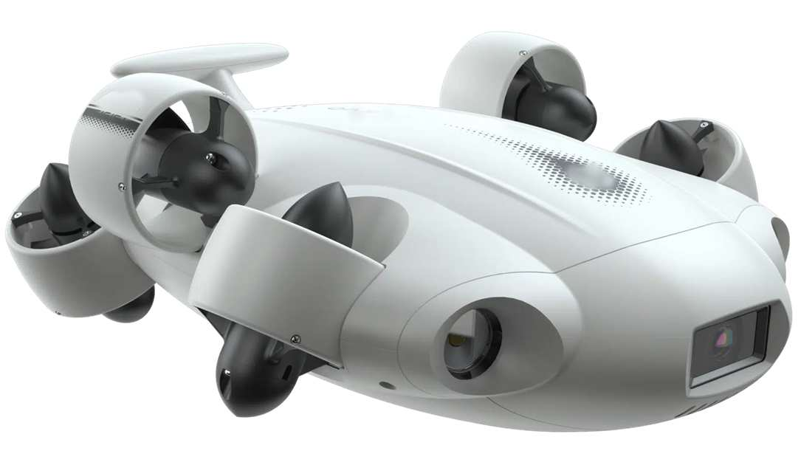

<div align="center">

# Dron Submarino

**Controlador de un dron submarino ideal con el microcontrolador 80C552**



Práctica final · Arquitectura de Computadores · curso 2026-2027
Grado en Ingeniería Informática de Gestión y Sistemas de Información · UPV/EHU


</div>

---

## Descripción

Software de control para un pequeño dron submarino. El dron sigue un recorrido
automático a partir de un programa guardado en la memoria de datos (de `0x50` a `0x7F`),
midiendo profundidad y distancia con sensores analógicos y moviendo sus hélices mediante PWM.

El programa está organizado como una **máquina de estados** (estados – eventos – acciones).

## Simulación

Animación en bucle (40 s) renderizada por raytracing. Encadena tres recorridos, que cubren los casos del enunciado:

| Recorrido | Programa | Qué muestra |
|:---:|---|---|
| 1 | `C2 A5 D2 A3 E2 A4 F0` | Recorrido completo: baja a 5 m, avanza, gira y sube al llegar a `F`. |
| 2 | `C3 E4 A6 D1 A8 F0` | Durante el giro `E4` hay un obstáculo a menos de 0,2 m y se ignora. Durante el avance `A8` otro obstáculo aborta el rastreo y el dron sube. |
| 3 | `C1 D5 A4 F0` | Se pulsa Marcha/Paro durante el giro `D5` y el dron sube. |

<div align="center">


</div>

Otras versiones: [WebP ligera 960x540](img/dron.webp) · [vídeo MP4 a 3200x1800](img/dron_4k.mp4). Tabla completa de fases: [img/dron_tiempos.md](img/dron_tiempos.md).

> Ilustración del comportamiento esperado, no la ejecución del código. Parámetros de la animación que no vienen en el
> enunciado: avance 0,5 m/s, giro 45 °/s, descenso y ascenso de 3 s, y 1 s de animación = 1,4 s de sistema.
> Con el paro se supone que el dron sube.

### Simulador interactivo

Versión interactiva con la lógica de la máquina de estados: [abrir el simulador](https://wertoxdd.github.io/Dron-Submarino/).
También se puede abrir directamente el archivo `docs/index.html` en cualquier navegador.

- **Botón Marcha/Paro** (P3.2), pausa, paso a paso y control de velocidad.
- **Programa editable** en hexadecimal (0x50 a 0x7F) con validación y ejemplos.
- **Obstáculo arrastrable** y sónar frontal que también detecta el muro del recinto.
- **Sensores**: valores del ADC de profundidad y de distancia en tiempo real.
- **Salidas**: PWM0, PWM1, Giro_Avance, Subir_Bajar y displays de siete segmentos.
- **Máquina de estados** con el estado activo, registro de eventos y gráfica de profundidad.

## Hardware

| Elemento | Detalle |
|---|---|
| Microcontrolador | Philips 80C552 |
| Reloj | Cristal de 24 MHz |
| Botón Marcha/Paro | P3.2 (interrupción externa) |
| Sensor de presión (profundidad) | ADC, P5.0 |
| Sensor de distancia (sónar frontal) | ADC, P5.1 |
| Hélices de profundidad | PWM0 + P1.5 (subir/bajar) |
| Hélices de giro/avance | PWM1 + P1.7, P1.6 |
| Visualización | Dos displays de 7 segmentos (P2 y P0) |

## Instrucciones del recorrido

Cada instrucción ocupa un byte: 4 bits altos = acción, 4 bits bajos = parámetro.

| Código | Acción | Parámetro |
|:---:|---|---|
| `C` | Subir / bajar | Profundidad (0 a 4) |
| `A` | Avanzar | 1–F segundos |
| `D` | Girar a la derecha | 1–F segundos |
| `E` | Girar a la izquierda | 1–F segundos |
| `F` | Fin (el dron sube) | – |

## Estructura del repositorio

```
.
├── README.md
├── docs/
│   └── index.html               # simulador interactivo
├── img/
│   ├── dron_submarino.jpg       # imagen del enunciado de la práctica
│   ├── dron_fhd.webp            # animación del README (1920x1080)
│   ├── dron.webp                # la misma animación, versión ligera (960x540)
│   ├── dron_4k.mp4              # la misma animación en vídeo a 3200x1800
│   └── dron_tiempos.md          # tabla de tiempos de la animación
├── tools/
│   └── generar_dron.py          # script que genera la animación
└── src/
    ├── src-dron_submarino.a     # código fuente en ensamblador
    └── *.Uv2 / *.Opt            # archivos de proyecto de Keil uVision2
```

## Cómo trabajar con el proyecto

1. Abre `src/src-dron_submarino.Uv2` con Keil uVision2.
2. Compila y simula desde el propio entorno.

### Normas del equipo

- Todo el proyecto vive dentro de esta carpeta. Usa rutas relativas al añadir archivos en uVision.
- Antes de trabajar: `git pull`. Al terminar: `git add . && git commit -m "mensaje" && git push`.
- Cierra el proyecto en uVision antes de hacer `pull` o `merge`.
- Avisa al equipo antes de añadir o quitar archivos del proyecto (`.uv2`), para evitar conflictos.
- No subas archivos generados (`.obj`, `.hex`, `.lst`…): ya están en `.gitignore`.

## Autoría

Proyecto desarrollado para la asignatura de Arquitectura de Computadores.
